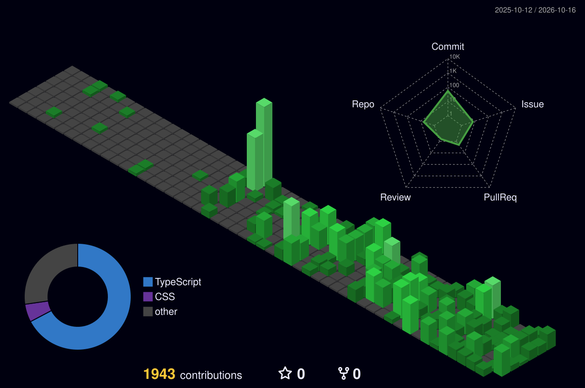

 

### Hi, I'm Noah 👋

Software Engineering student and **web & mobile developer**.
I build digital products designed for **African users and businesses** 🌍

- 🎯 **Focus:** full-stack web (React · Next.js · NestJS) and mobile apps
- 🔭 **Currently:** working on innovative projects
- 🌐 **Portfolio:** [noah-development.netlify.app](https://noah-development.netlify.app)
- 📫 **Email:** [ngandeu.noe27@gmail.com](mailto:ngandeu.noe27@gmail.com)

  
  
  

 

## ⚡ Tech Stack

<table align="center">
  <tr>
    <td align="center" width="150"><b>Languages</b></td>
    <td></td>
  </tr>
  <tr>
    <td align="center"><b>Frontend</b></td>
    <td></td>
  </tr>
  <tr>
    <td align="center"><b>Backend</b></td>
    <td></td>
  </tr>
  <tr>
    <td align="center"><b>Mobile</b></td>
    <td></td>
  </tr>
  <tr>
    <td align="center"><b>Data</b></td>
    <td></td>
  </tr>
  <tr>
    <td align="center"><b>DevOps</b></td>
    <td></td>
  </tr>
  <tr>
    <td align="center"><b>Tools</b></td>
    <td></td>
  </tr>
</table>

## 📊 GitHub Activity

  

## 🐍 Contribution Snake

<picture>
  <source media="(prefers-color-scheme: dark)" srcset="https://raw.githubusercontent.com/Noahdev27/Noahdev27/output/github-contribution-grid-snake-dark.svg" />
  <source media="(prefers-color-scheme: light)" srcset="https://raw.githubusercontent.com/Noahdev27/Noahdev27/output/github-contribution-grid-snake.svg" />
  
</picture>

 

<code>$ echo "Building the future of African tech, one commit at a time."</code>

